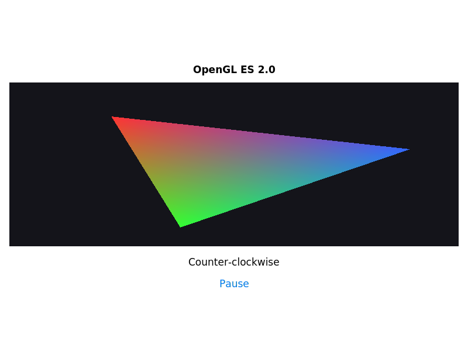
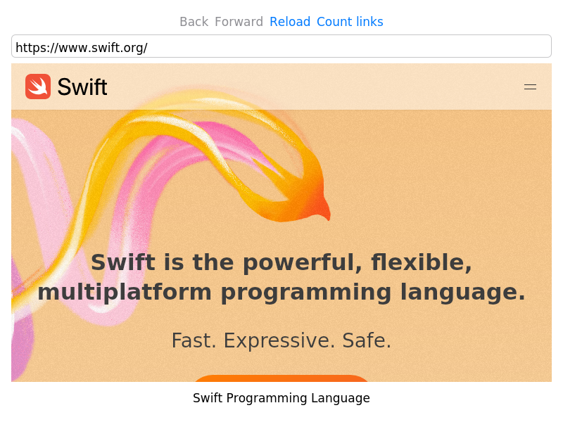
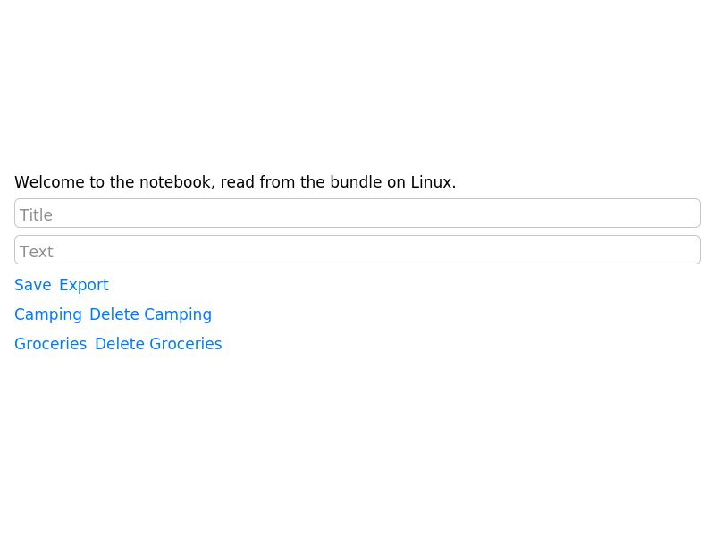

# LinuxAppRuntime

The Linux host for [AppRuntime](https://github.com/PureSwift/AppRuntime)
apps. An AppRuntime app is guest code only: a universal bundle with
`App.wasm` and native `libapp.a` slices. This repository turns one into a
Linux program:

- the **host runtime**: `main`, a main loop for timers and D-Bus, the
  runtime core behind `rt.h`, and the built-in contracts;
- the **SwiftUI player**: DarwinAppRuntime's renderer of the SwiftUI
  frontend's render IR, on [Cacao](https://github.com/PureSwift/Cacao),
  SwiftUI for Linux;
- **Bluetooth** LE central over BlueZ's D-Bus API;
- **GL surfaces**: OpenGL ES 2.0 in a SwiftUI view, over EGL;
- **web views**: WPE WebKit pages in a SwiftUI view;
- the **packager**, `linux-app`, which turns a universal bundle into an
  installable app.

**Status:** AppRuntime's `ExampleUI`, built as a `linux-arm64` slice, runs
in the player on Cacao, headless under SDL's offscreen driver, and the
player passes DarwinUI's own tests there. PortMaster ports don't build on
Cacao yet ([PortMaster.md](Documentation/PortMaster.md) §7). The Bluetooth
contracts are tested against a fake BlueZ and haven't run against real
hardware. `linux-app` packages `ExampleUI` from its bundle, as a slice or
through wasm2c, and the packaged app runs. See the
[plan](Documentation/Plan.md) and the [packager](Documentation/Packager.md).


`ExampleGL` draws its triangle in a `GLSurface` the same way, with Mesa's
llvmpipe:



`ExampleWeb` shows a page in a `WebView` with WPE WebKit:



`ExampleFiles` reads its welcome text from the bundle and lists the notes
in its `documents`:



`ExampleModel` keeps to-do lists in a model store with CoreModel, kept in
SQLite. At its second launch it reads back what's there, here two to-dos
added to its database between launches:


## Modules

| Module | |
|---|---|
| `LinuxHost` | `AppHost` (built-ins, modules, `rt_main`), `MainLoop` and its clock, the `Bundle` built-in, `LinuxFiles` and `LinuxDefaults`, the app's files and settings in XDG's directories or a container ([plan](Documentation/Plan.md) §9), over AppRuntime's shared `RuntimeHost` (`AppInfo`, compatibility checks, `HostModule`, `Permissions`, `Application`, `HostFiles`, `HostDefaults`) |
| `LinuxUI` | The SwiftUI player: DarwinAppRuntime's `DarwinUI`, copied by `Scripts/sync-darwinui.sh`, over Cacao's `SwiftUI` |
| `LinuxBluetooth` | `BluetoothCentral`, `BluetoothPeripheral`, `BluetoothService`, `BluetoothCharacteristic`, `BluetoothDescriptor` and `BluetoothAdvertisement` over BlueZ, through `wendylabsinc/dbus` |
| `LinuxGraphics` | `Surface`: GLES 2.0 drawn in EGL pbuffers, loaded at run time, and read back into the player's `GLSurface` view ([plan](Documentation/Plan.md) §7) |
| `LinuxWebKit` | `WebContent`: WPE WebKit pages, loaded at run time, drawn into shared memory and shown by the player's `WebView` view ([plan](Documentation/Plan.md) §8) |
| `LinuxCoreModel` | `LinuxModelStore`: the app's CoreModel stores in SQLite, through AppRuntime's `HostModelStore` and CoreModel-SQLite ([plan](Documentation/Plan.md) §9) |
| `LinuxHostApp`, `linux-app-host` | The app's `main`: the host, and Cacao's window and loop. It also registers AppRuntime's `RuntimeFormatting`, dates and numbers over Swift Foundation ([plan](Documentation/Plan.md) §3) |
| `LinuxPackager`, `linux-app` | The packager: validation, the host build, wasm2c, the install tree, PortMaster ports |

## Building

Swift 6.4.2 (`.swift-version`) on Debian 13; SDL 3.4, Cairo, FreeType,
fontconfig and Wayland for Cacao; EGL and GLES 2.0, which GL surfaces load
at run time and apps that draw link (Mesa's draw without a GPU); and WPE
WebKit, which web views load at run time:

```sh
apt-get install cmake ninja-build git libcairo2-dev libfreetype-dev libfontconfig-dev \
    libwayland-dev wayland-protocols fonts-dejavu-core \
    libegl1 libegl-mesa0 libgles-dev libgl1-mesa-dri \
    libwpewebkit-2.0-1 libwpebackend-fdo-1.0-1 libwayland-server0
Scripts/build-sdl3.sh /usr -DCMAKE_INSTALL_LIBDIR=lib/$(uname -m)-linux-gnu
swift build
swift test
```

Debian's SDL is 3.2, and PureSwift/SDL needs 3.4, so `build-sdl3.sh`
builds it. Ubuntu 26.04 doesn't package WPE WebKit. In a container, WebKit's
web processes need `WEBKIT_DISABLE_SANDBOX_THIS_IS_DANGEROUS=1`: its
bubblewrap sandbox can't make namespaces there.

The `Dockerfile` has all of it; `Scripts/docker.sh` runs a command there,
with this checkout at `/src`:

```sh
Scripts/docker.sh swift test --scratch-path .build/linux
```

AppRuntime and Cacao (its `develop` branch) come from GitHub.
`APPRUNTIME_PATH` and `CACAO_PATH` point at local checkouts instead, and
`Scripts/docker.sh` mounts them.
`Scripts/sync-darwinui.sh` updates the player from a DarwinAppRuntime
checkout beside this one.

## Packaging an app

Build a universal bundle with a Linux slice with AppRuntime's `guest.py`
(the bundle step also needs the wasm Swift SDK):

```sh
python3 ~/Developer/AppRuntime/Scripts/guest.py bundle --product ExampleUI \
    --id org.pureswift.ExampleUI --name ExampleUI --version 1.0 --build 1 \
    --target linux-arm64 --output .build/guest
```

Then, on Linux:

```sh
swift build --product linux-app
.build/debug/linux-app validate .build/guest/org.pureswift.ExampleUI.app
.build/debug/linux-app package .build/guest/org.pureswift.ExampleUI.app --archive
.build/debug/linux-app install .build/guest/org.pureswift.ExampleUI.app
.build/debug/linux-app run .build/guest/org.pureswift.ExampleUI.app
```

`package` writes an install tree (`bin/`, `lib/<id>/`, a desktop entry and
icon) and, with `--archive`, a tarball of it; `install` puts it in
`~/.local`. `--engine wasm2c` builds from `App.wasm` instead of a slice,
which needs WABT (`apt install wabt`). The packaged program takes:

| Argument | |
|---|---|
| `--open URL` | A URL for the app to open |
| `--bundle App.app` | Another bundle's keys; `App.app` next to the program by default |

`Scripts/run-app.sh` links a bundle's slice into `linux-app-host` and runs it
in Docker, headless, saving its first frame:

```sh
mkdir -p .build/shots
Scripts/run-app.sh .build/guest/org.pureswift.ExampleUI.app .build/shots/ExampleUI.png
```

## PortMaster

`linux-app portmaster` makes a [PortMaster](https://portmaster.games) port
for aarch64 and armhf handhelds: the host built for their older glibc, SDL3
built for them, a launcher, gamepad controls and the catalogue's metadata
([design](Documentation/PortMaster.md)). Ports don't build on Cacao yet:
their images need Cairo built for old glibc, and Cacao needs the handheld
options the earlier player had (§7 there). In Docker:

```sh
Scripts/portmaster.sh build .build/guest/org.pureswift.ExampleUI.app all --porter "Your Name"
Scripts/portmaster.sh test aarch64
```

The bundle needs `linux-arm64` and `linux-armv7` slices (`guest.py bundle
--target linux-arm64 --target linux-armv7`). Ports go to
`.build/portmaster/<port>/`, laid out as in PortMaster's repository, and
`<port>.zip`.

| Variable | |
|---|---|
| `LINUXAPPRUNTIME_DEBUG` | `1` logs the host's debug messages |
| `LINUXAPPRUNTIME_CONTAINER` | An absolute path that holds the app's files (`Documents`, `Data`, `Caches`, `tmp`) settings (`Defaults`) and model stores (`Stores`), in place of XDG's directories |
| `CACAO_SCREENSHOT` | Saves the first frame to a PNG and quits |
| `CACAO_SHOW_STATISTICS` | `1` shows Cacao's frame times |
| `SDL_VIDEO_DRIVER` | `wayland`, `x11`, `kmsdrm`, or `offscreen` for no display |
