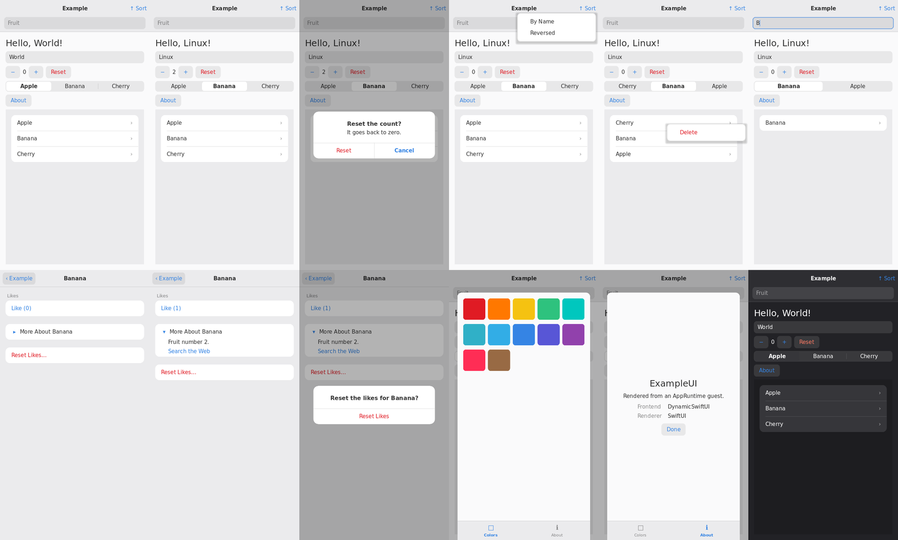

# LinuxAppRuntime

The Linux host for [AppRuntime](https://github.com/PureSwift/AppRuntime)
apps. An AppRuntime app is guest code only: a universal bundle with
`App.wasm` and native `libapp.a` slices. This repository turns one into a
Linux program:

- the **host runtime**: `main`, a main loop that SDL, timers and D-Bus all
  wake, the runtime core behind `rt.h`, and the built-in contracts;
- the **SwiftUI player**, which lays out and draws the SwiftUI frontend's
  render IR with SDL3 and SDL3_ttf, and sends input back;
- **Bluetooth** LE central over BlueZ's D-Bus API;
- the **packager**, `linux-app`, which turns a universal bundle into an
  installable app.

**Status:** AppRuntime's `ExampleUI`, built as a `linux-arm64` slice, runs
in the player: text fields, steppers, pickers, alerts, menus, swipe actions
(as context menus), search, navigation, forms, disclosure groups,
confirmation dialogs, sheets, tab views and lazy grids all render and reach
the guest and back, headless under SDL's offscreen driver. The Bluetooth
contracts are tested against a fake BlueZ and haven't run against real
hardware. `linux-app` packages `ExampleUI` from its bundle, as a slice or
through wasm2c, and the packaged app runs. See the
[plan](Documentation/Plan.md) and the [packager](Documentation/Packager.md).



## Modules

| Module | |
|---|---|
| `LinuxHost` | `AppHost` (checks, built-ins, modules, `rt_main`), `AppInfo`, `MainLoop` and its clock, `Permissions`, `Bundle`, `Application` |
| `LinuxUI` | The player's model without SDL: render store, layout, drawing to a `Canvas`, input, text editing, lazy rows, navigation, presentations |
| `LinuxSDL` | The window, `SDL_Renderer` canvas, SDL3_ttf text with fontconfig's fonts (or bundled ones), and SDL as the main loop's driver, over [PureSwift/SDL](https://github.com/PureSwift/SDL)'s `SDL3Swift` and `CSDL3TTF` |
| `LinuxBluetooth` | `Central`, `Peripheral`, `Service`, `Characteristic`, `Descriptor` and `Advertisement` over BlueZ, through `wendylabsinc/dbus` |
| `LinuxHostApp`, `linux-app-host` | The app's `main` |
| `LinuxPackager`, `linux-app` | The packager: validation, the host build, wasm2c, the install tree, PortMaster ports |

## Building

Swift 6.4.2 (`.swift-version`), SDL3, SDL3_ttf and fontconfig:

```sh
apt-get install libsdl3-dev libsdl3-ttf-dev libfontconfig-dev fonts-dejavu-core
swift build
swift test
```

The `Dockerfile` has all of it; `Scripts/docker.sh` runs a command there,
with this checkout at `/src`:

```sh
Scripts/docker.sh swift test --scratch-path .build/linux
```

AppRuntime and PureSwift/SDL come from GitHub. `APPRUNTIME_PATH` and
`SDL_PATH` point at local checkouts instead.

## Packaging an app

Build a universal bundle with a Linux slice with AppRuntime's `guest.py`
(the bundle step also needs the wasm Swift SDK):

```sh
python3 ~/Developer/AppRuntime/Scripts/guest.py bundle --product ExampleUI \
    --id org.pureswift.ExampleUI --name ExampleUI --version 1.0 --build 1 \
    --target linux-arm64 --output .build/guest
```

Then, on Linux:

```sh
swift build --product linux-app
.build/debug/linux-app validate .build/guest/org.pureswift.ExampleUI.app
.build/debug/linux-app package .build/guest/org.pureswift.ExampleUI.app --archive
.build/debug/linux-app install .build/guest/org.pureswift.ExampleUI.app
.build/debug/linux-app run .build/guest/org.pureswift.ExampleUI.app
```

`package` writes an install tree (`bin/`, `lib/<id>/`, a desktop entry and
icon) and, with `--archive`, a tarball of it; `install` puts it in
`~/.local`. `--engine wasm2c` builds from `App.wasm` instead of a slice,
which needs WABT (`apt install wabt`). The packaged program takes:

| Argument | |
|---|---|
| `--script FILE` | Replays input and takes screenshots (`Scripts/ExampleUI.script`) |
| `--open URL` | A URL for the app to open |
| `--bundle App.app` | Another bundle's keys; `App.app` next to the program by default |

`Scripts/run-app.sh` links a bundle's slice into `linux-app-host` and runs it
in Docker, headless:

```sh
mkdir -p .build/shots
Scripts/run-app.sh .build/guest/org.pureswift.ExampleUI.app --script /src/Scripts/ExampleUI.script
```

## PortMaster

`linux-app portmaster` makes a [PortMaster](https://portmaster.games) port
for aarch64 and armhf handhelds: the host built for their older glibc, SDL3
built for them, a launcher, gamepad controls and the catalogue's metadata
([design](Documentation/PortMaster.md)). In Docker:

```sh
Scripts/portmaster.sh build .build/guest/org.pureswift.ExampleUI.app all --porter "Your Name"
Scripts/portmaster.sh test aarch64 /src/Scripts/ExampleUI-handheld.script
```

The bundle needs `linux-arm64` and `linux-armv7` slices (`guest.py bundle
--target linux-arm64 --target linux-armv7`). Ports go to
`.build/portmaster/<port>/`, laid out as in PortMaster's repository, and
`<port>.zip`.

| Variable | |
|---|---|
| `LINUXAPPRUNTIME_WINDOW_SIZE` | The window's size in points, `WIDTHxHEIGHT`; 420x760 by default |
| `LINUXAPPRUNTIME_APPEARANCE` | `light` or `dark`; the system's by default |
| `LINUXAPPRUNTIME_DEBUG` | `1` logs the host's debug messages |
| `LINUXAPPRUNTIME_FULLSCREEN` | `1`: one fullscreen window |
| `LINUXAPPRUNTIME_SCALE` | Pixels per point beyond the display's density |
| `LINUXAPPRUNTIME_CURSOR` | `1`: draw the pointer, for screens without one |
| `LINUXAPPRUNTIME_FONTS` | A directory of fonts, for systems without fontconfig |
| `LINUXAPPRUNTIME_SCRIPT` | A script, as `--script` |
| `SDL_VIDEO_DRIVER` | `wayland`, `x11`, `kmsdrm`, or `offscreen` for no display |
